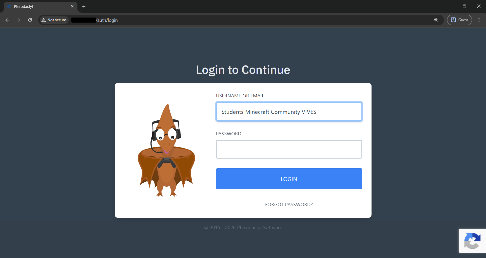
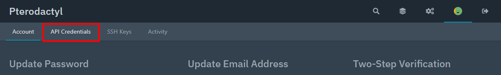
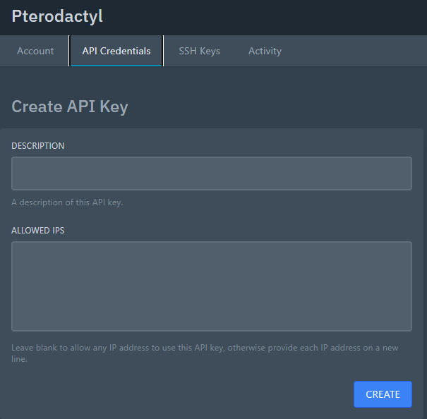

## 2. Pterodactyl API Key Instellen

Om n8n opdrachten te laten uitvoeren op de Minecraft-server, heeft n8n de juiste toegangsrechten nodig. Dit doe je door een API Key aan te maken in het Pterodactyl Panel. Volg hiervoor de onderstaande stappen:

1. Open het **Pterodactyl Panel** en log in.
    
2. Ga naar je **Account Settings** (Accountinstellingen).
   
3. Klik vervolgens op het tabblad **API Credentials**.
   
4. Op deze pagina zie je het gedeelte **Create API Key**. Vul hier de volgende instellingen in:
   
   * **Description:** Geef de sleutel een duidelijke herkenbare naam, bijvoorbeeld `"N8N_Key"`.
   * **Allowed IPs:** Vul hier het IP-adres in van de server waarop n8n draait. Dit is een belangrijke beveiligingsstap, zodat de API-sleutel alléén vanaf de n8n-server gebruikt kan worden.
5. Genereer de sleutel en **kopieer deze direct**. 

Deze gekopieerde API Key voer je vervolgens in als credential binnen je n8n-omgeving. Hiermee is de authenticatie voltooid en heeft n8n veilig en gecontroleerd toegang tot het Pterodactyl Panel.